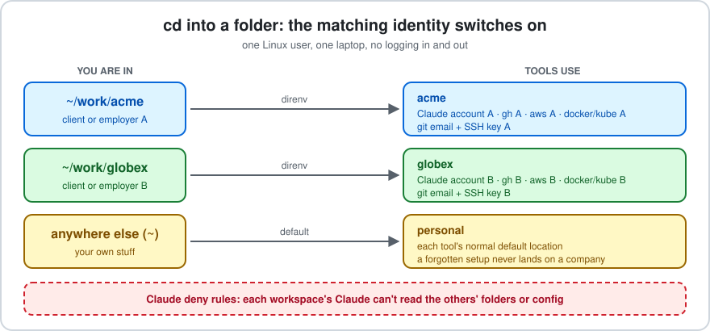

# direnv-workspaces

**Work for several clients or employers from one laptop without mixing up accounts.**
`cd` into a folder and your Claude Code account, `gh`, `aws`, `docker`, `kube`, npm config, git email and SSH key switch to that folder's identity. No logging in and out.



## Why

| Without it | With it |
|---|---|
| One `gh`/`aws`/Claude login at a time; you log out and in between projects | Each folder has its own logins, all valid at once |
| A commit lands with the wrong email, or a push uses the wrong SSH key | `includeIf` picks the email and key by folder |
| A tool started from a dock icon or cron uses whatever was logged in last | Anything started without workspace env falls back to *personal*, never to a company |
| Claude Code memory, plugins and history from one client leak into another | Each workspace has its own Claude config and memory, with no credentials copied |
| Claude can read a different client's folder by accident | Deny rules block each workspace's Claude from the others' folders and config |
| Setting up a new client takes an afternoon | `ws new acme you@acme.com`, then log in once |

## How it works

1. **personal** uses every tool's default location (`~/.claude`, `~/.config/gh`, `~/.aws`, ...).
2. Each other workspace lives in `~/.config/workspaces/<name>/` and applies only inside its folder `~/work/<name>/`.
3. A one-line `.envrc` in that folder points [direnv](https://direnv.net) at the workspace. On `cd`, direnv sets the tools' config-dir variables (`CLAUDE_CONFIG_DIR`, `GH_CONFIG_DIR`, `AWS_CONFIG_FILE`, ...). A git `includeIf` rule sets the email and SSH key.
4. Leaving the folder restores personal.

## Not a security boundary

Everything runs as one Linux user. Any program you run can read every file. This prevents *accidents* (wrong account, wrong key, wrong email), not hostile code. For a hard wall use a dev container or a second Linux user.

## Install

Requires `bash`, `git`, `jq` and `direnv`.

### Platform support

| Platform | Status |
|---|---|
| Linux | Tested (bash and zsh). |
| macOS | **Untested, expected to mostly work.** See below. |
| Windows | Not supported (use WSL, which counts as Linux). |

**macOS, untested.** Nobody has run this on a Mac yet. The scripts avoid GNU-only tools and bash 4+ features, so stock macOS (bash 3.2, zsh, BSD userland) should work. Install the dependencies with `brew install jq direnv`. CI runs `test/selftest.sh` on macOS (`.github/workflows/selftest.yml`); check its result before relying on it.

Known or possible differences on macOS:
- The Claude Desktop launcher (`ws launcher`, `ws desktop`) writes Linux `.desktop` files and is Linux-only. `ws new` skips it automatically.
- Tools that store logins in the macOS Keychain or under `~/Library` may ignore the config-dir variables, so two workspaces could share one login. This is unverified for `gh`, `docker` and Claude Code. After `ws new`, log in inside each workspace and check with `ws` and the tool's own status command (`gh auth status`, `claude` then `/status`).
- The `gh` keyring gotcha in `docs/howto.md` mentions `secret-tool` (Linux). On macOS the token lives in Keychain instead.
- Reports and fixes are welcome via issues or pull requests.

```bash
git clone https://github.com/chasanc/direnv-workspaces.git
cd direnv-workspaces
./install.sh            # add --no-shell to leave ~/.bashrc / ~/.zshrc alone
```

Open a new terminal, then:

```bash
ws new acme you@acme.com   # creates ~/work/acme and the workspace config
cd ~/work/acme && ws       # shows the active workspace
```

`ws new` prints the remaining steps (ssh key, `claude` login, `gh auth login`, ...). Run them inside the new folder. Change the work root with `export WS_WORK=/path`.

Check the repo itself with `test/selftest.sh` (uses a throwaway `HOME`).

## Commands

| Command | Does |
|---|---|
| `ws` | show the active workspace and where each tool points |
| `ws list` | list workspaces and their folders |
| `ws new <name> [email]` | create a workspace and its folder `$WS_WORK/<name>` |
| `ws add <name> <folder>` | link another folder to a workspace |
| `ws launcher <name>` / `ws desktop <name>` | Claude Desktop with that workspace's profile (needs `claude-desktop`) |

## Secrets

Put per-workspace environment tokens in `~/.config/workspaces/<name>/secrets/<VAR_NAME>` (`chmod 600`, one file per variable). They are exported only inside that workspace. Never put secrets in `.envrc` or a repo.

## Repo layout

| Path | Purpose |
|---|---|
| `install.sh` | installs `ws` and the config, hooks direnv into your shell |
| `bin/ws` | the helper |
| `config/isolated.sh` | shared env for every non-personal workspace |
| `config/personal.envrc` | personal's envrc: unsets every override |
| `config/shell-hook.sh` | default-to-personal, direnv hook and prompt tag |
| `test/selftest.sh` | end-to-end test in a throwaway `HOME` |
| `docs/howto.md` | add a workspace / folder / tool, remove, troubleshoot |

## License

MIT
